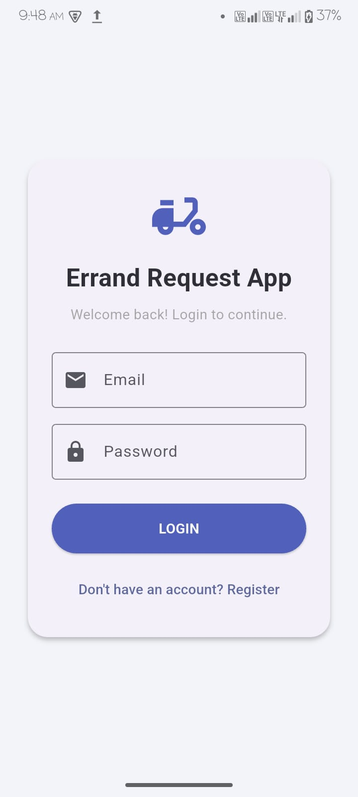
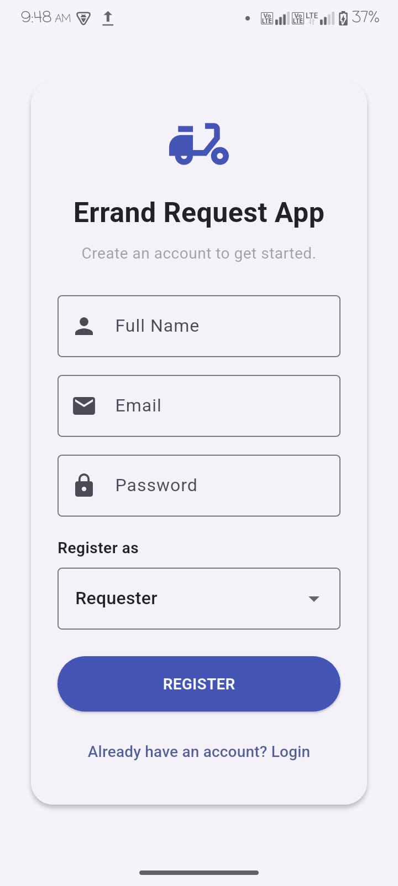
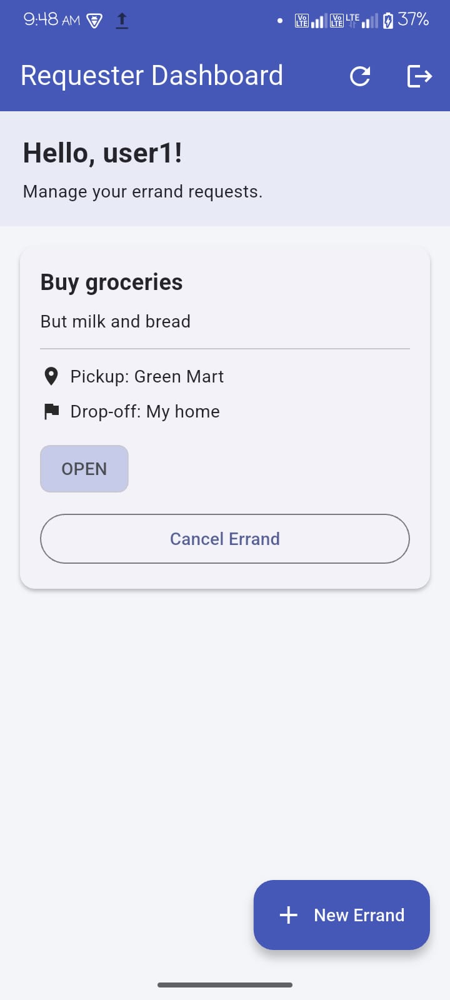
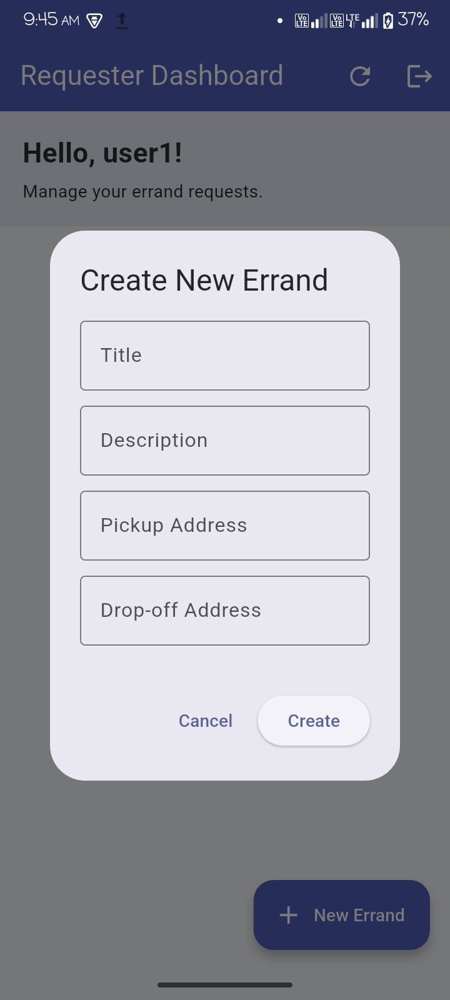
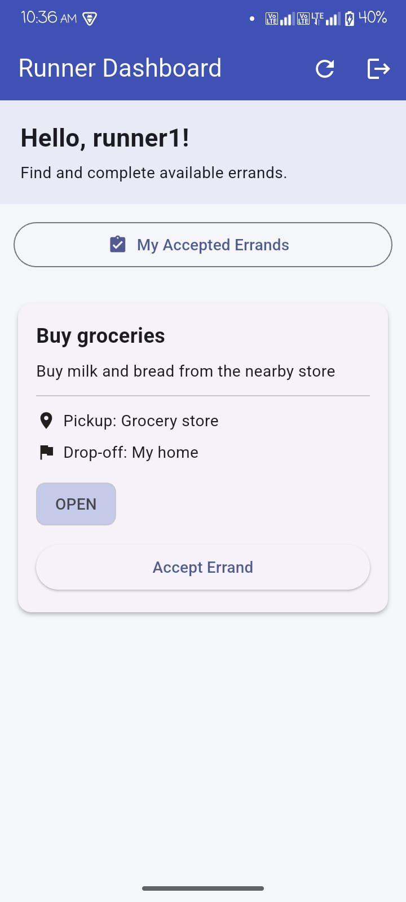
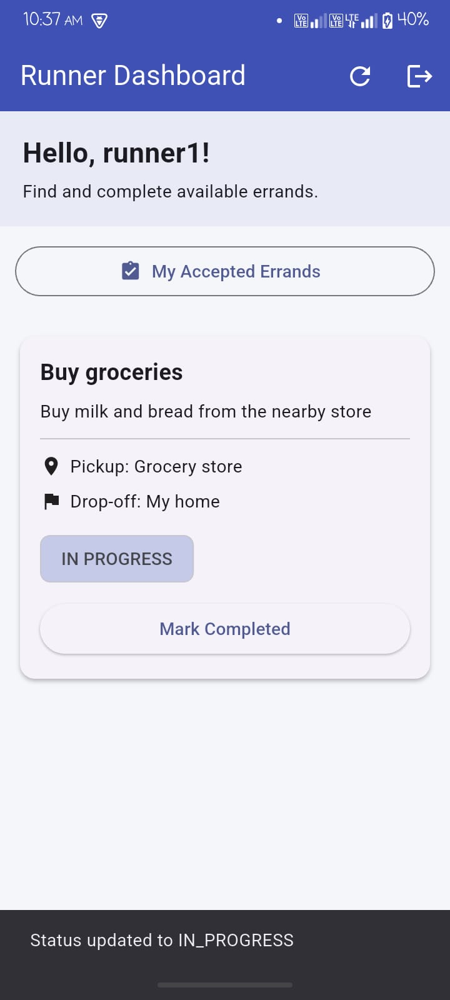

# Errand Request App

A mobile application that connects people who need errands completed (Requesters) with people willing to complete them (Runners).

## Features

### Requester
- Register and log in.
- Create errands with title, description, pickup and drop-off addresses.
- View personal errands and their current status.
- Cancel errands while they are Open.

### Runner
- Register and log in.
- Browse available errands.
- Accept an available errand.
- View accepted errands.
- Update progress from Accepted to In Progress to Completed.

## Technology Stack

**Mobile:** Flutter, Dart

**Backend:** NestJS, TypeScript, Node.js

**Database:** PostgreSQL (Neon)

**ORM:** Prisma

**Authentication:** JWT, bcrypt

## Architecture

Flutter Mobile App → NestJS REST API → Prisma ORM → PostgreSQL Database

## Project Structure

```text
ErrandRequestApp/
├── backend/
│   ├── prisma/
│   ├── src/
│   │   ├── auth/
│   │   ├── errands/
│   │   └── prisma/
│   ├── .env.example
│   └── package.json
│
├── mobile/
│   ├── lib/
│   │   ├── screens/
│   │   ├── services/
│   │   └── main.dart
│   └── pubspec.yaml
│
└── README.md
```

## Setup Instructions

### 1. Clone the repository

```bash
git clone YOUR_GITHUB_REPOSITORY_URL
cd ErrandRequestApp
```

### 2. Backend setup

```bash
cd backend
npm install
```

Create a `.env` file using `.env.example` and configure:

```env
DATABASE_URL="your_postgresql_connection_string"
JWT_SECRET="your_secret_key"
PORT=3000
```

Run database migrations and generate the Prisma client:

```bash
npx prisma migrate deploy
npx prisma generate
```

Start the backend:

```bash
npm run start:dev
```

Backend runs at `http://localhost:3000`.

### 3. Mobile setup

Open another terminal:

```bash
cd mobile
flutter pub get
flutter run
```

For a physical Android device connected through USB, configure port forwarding:

```bash
adb reverse tcp:3000 tcp:3000
```

## Errand Status Flow

```text
OPEN → ACCEPTED → IN_PROGRESS → COMPLETED
  |
  └── CANCELLED
```

## Business Rules

- Only Requesters can create and cancel errands.
- Only Runners can accept and update errands.
- An errand can be accepted by only one Runner.
- A Runner cannot have multiple active errands.
- Errand status transitions must follow the defined sequence.
- Requesters can access only their own errands.
- Completed and Cancelled errands are terminal states.

## Security

- Passwords are hashed using bcrypt.
- JWT-based authentication protects API endpoints.
- Role-based authorization restricts operations.
- Environment variables are used for sensitive configuration.


## Application Screenshots

### Authentication

| Login | Registration |
|---|---|
|  |  |

### Requester

| Requester Dashboard | Create Errand |
|---|---|
|  |  |

### Runner

| Runner Dashboard | Accepted Errand |
|---|---|
|  |  |


## Future Improvements

- Improved UI and user experience.
- Automated backend and mobile tests.
- Production deployment.

---

**Built with Flutter, NestJS, Prisma and PostgreSQL.**